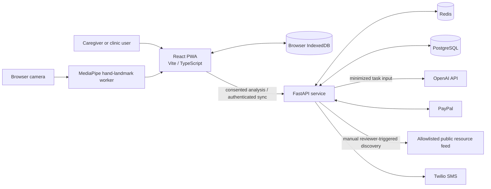
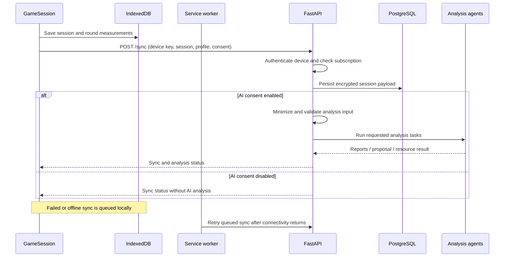

# DexPlay architecture

This document describes the current implementation in this repository. DexPlay is an offline-capable React PWA with an optional cloud API. It is a proof of concept, not a clinically validated system or a production service for patient data.

## System overview

The browser is the primary runtime for local practice. The cloud API is optional for gameplay and is used for consented AI analysis, subscriber sync, resource catalog/review operations, and payment-related flows.

## Repository components

### Web PWA (`web/`)

- `src/main.tsx` mounts the React app and shared styles.
- `src/App.tsx` owns startup initialization, the active profile and settings, screen selection, and app-level cloud operations. Screens are selected with local React state rather than a URL-routing library.
- `src/components/GameSession.tsx` implements the game modes, round timing, scoring, and local result persistence.
- `src/cv/CameraCoach.tsx` manages camera access and calibration. `src/cv/hand-worker.js` runs the hand-landmark model in a Web Worker; detected fingertip motion is mapped to calibrated mat regions.
- `src/components/ReportsScreen.tsx` combines local measurements and history with available cloud feedback.
- `src/db/index.ts` defines the IndexedDB stores and persistence helpers.
- `src/i18n.ts` loads the selected locale; `src/i18n/*.json` and `reportTranslations.ts` provide interface strings.
- `src/sw.ts` and the Vite PWA configuration provide installability, offline app-shell support, background sync, and runtime caching for the hand model and WASM assets.
- `src/app-polish.css`, `src/reports.css`, and `src/camera.css` contain shared and feature-specific presentation styles.

`CameraCoach_opencv.tsx` and `GameSession_opencv.tsx` are alternate files; the default game path uses the MediaPipe worker. The development-only `/camera-bench` path is not a production screen.

### API (`api/`)

- `app/main.py` creates the FastAPI application and defines HTTP endpoints, middleware, request logging, CORS, and authentication dependencies.
- `app/config.py` loads and validates environment configuration.
- `app/db.py`, `app/models/entities.py`, and `migrations/` manage asynchronous PostgreSQL access, SQLAlchemy entities, and schema evolution.
- `app/security.py` hashes device keys and encrypts sensitive payloads.
- `app/orchestrator.py` coordinates independent analysis agents and partial results.
- `app/agents/` contains task-specific LLM agents, privacy input shaping, report writing/translation, adaptive settings, and resource selection.
- `app/services/` contains public-feed discovery and PayPal/Twilio integrations.
- `app/celery_app.py` and `app/tasks.py` configure queued background work, including optional SMS delivery through Redis and Twilio.
- `tests/` contains API unit and integration-flow tests; the Postman collection documents representative HTTP requests.

## Browser and data lifecycle

### First run and local practice

1. On startup, the app reads settings and profile records from IndexedDB. If there is no saved profile and play group, it shows setup; otherwise it restores the current profile.
2. The profile, clinic roster, preferences, calibration, game sessions, round measurements, and cached resource data are stored locally. `localStorage` is used for initial language detection; IndexedDB is the main application store.
3. Camera permission is requested in the browser. The camera image is processed locally by the hand-landmark worker, and detected hand movement drives game interaction with the calibrated mat. Frames are not sent to the API.
4. The game writes its session and round results locally before any cloud operation. Local scores and history do not require a subscription or AI.

### Optional sync and offline queue

When cloud access is configured, eligible sessions can be submitted to `POST /sync`. The API authenticates a device key and checks its account/subscription status. The browser queues work when offline or when a request fails; the service worker can retry queued work later.

Before queue items are sent, the client resolves the current profile and rechecks that profile's current AI-consent setting. Legacy queue entries without a profile association are not sent for AI analysis. Syncing measurements to the cloud and consenting to AI analysis are distinct: a cloud session can be stored without running the analysis agents when consent is off.

## AI responsibilities and boundaries

DexPlay has two distinct uses of machine learning:

1. **On-device computer vision:** MediaPipe's hand-landmark model processes camera frames in the browser to track play. This is not a generative AI call; it does not transmit video.
2. **Optional server-side LLM tasks:** OpenAI receives a minimized task-specific payload only when the relevant request includes explicit AI consent and the required service conditions are met.

The LLM is not the source of game measurements and does not randomly choose a report. Session measurements come from game rounds saved by the client. The API's privacy helpers validate and narrow inputs before they reach model calls. The model may explain patterns in the supplied session context, generate audience-specific wording, or propose bounded next-game settings; it cannot change the measured score. Generated feedback is general and is not a diagnosis or individualized clinical advice. A proposed difficulty change is applied only after a user accepts it.

### Analysis paths

- **Free analysis (`POST /analysis/free`):** A pseudonymous brief-analysis path with rate limiting. It does not require the paid device-key sync flow. A successful response depends on explicit consent, API availability, limits, and the configured model provider.
- **Cloud sync (`POST /sync`):** Stores an encrypted session for an authenticated active device. With AI consent, the orchestrator runs adaptive, report, payment-recommendation, and resource-selection agents concurrently. Agent failures can produce partial results; status fields distinguish missing output from generated output.
- **Report translation (`POST /reports/translate`):** A separate authenticated, consent-gated operation. It receives report text, audience, and source/target language and asks the translation agent to translate without adding new clinical interpretation. The browser requests it only when consent, connectivity, and a device key are available. Translations are cached locally. If translation is unavailable, the UI hides untranslated feedback.
- **Resource matching:** The resource agent ranks items from the reviewed/published catalog. It does not conduct arbitrary web search. Feed discovery is a separate, manually triggered reviewer operation.

Do not treat AI-generated text as a diagnosis, clinical decision, guaranteed report, or replacement for a qualified professional. When AI is disabled or unavailable, local measurements and session history remain available.

## API, authorization, and persistence

The principal API areas are:

| Area | Purpose |
|---|---|
| `/health/*` | Liveness and readiness checks |
| `/keys/*` | Activate a device key and associate it with an account |
| `/analysis/free` | Rate-limited pseudonymous brief analysis |
| `/sync` | Authenticated encrypted session persistence and optional orchestration |
| `/reports/translate` | Consent-gated report translation for an authenticated device |
| `/resources` | Return matching published resources |
| `/review/resources/*` | Protected candidate discovery, review, publication, and rejection |
| `/paypal/*` | Subscription checkout, claims, config status, and signed webhooks |
| `/privacy/*` | Account-scoped export and deletion operations |
| `/clinic/dashboard` | API clinic-dashboard endpoint; the current PWA roster is local and does not call this endpoint |

Device keys are 12-character API keys; the API hashes them with a server pepper for lookup. Authenticated endpoints resolve an active device/account and, where required, an active subscription. Reviewer authorization is separate and reads the server-only `RESOURCE_REVIEWER_TOKEN` from the HTTP Authorization header.

PostgreSQL holds account, device-key, encrypted session, subscription/webhook, curated-resource, candidate, and discovery records. Sensitive session payloads and phone fields are encrypted before persistence. API-key hashes and activation-claim hashes are stored instead of reusable secrets. Redis supports rate limiting and Celery queues. Alembic migrations are run by the API container before Uvicorn starts.

Account deletion removes cloud account data; local browser data has a separate on-device deletion action. Preserve and back up the encryption key securely: replacing it makes existing encrypted records unreadable.

## Resource discovery and human review

The public resource catalog is populated only through explicit review and publication:

1. A designated reviewer supplies the reviewer token in the protected UI.
2. The reviewer can load pending candidates and published records, or manually trigger discovery from the approved public feed.
3. The discovery service validates feed URLs against an allowlist and enforces a daily request limit. The current proof of concept uses The OT Toolbox public RSS feed; it does not bypass blocked sources.
4. Each candidate remains unpublished until a reviewer confirms link/access status, license or copyright information, intended age range, relevance, safety notes, and required review notes.
5. Publication requires free public access and complete review metadata. Clinic recommendation is a separate explicit decision with supporting evidence.
6. Public resource matching returns only published resources. External resources remain labelled as externally sourced and are not clinic-recommended without explicit approval.

This workflow is not an automated clinical validation process. Reviewers are responsible for checking licensing, suitability, safety, and source availability.

## Payments and notifications

PayPal mode is selected by server configuration, not by a browser control. Live and sandbox credentials/plan IDs are separate; production configuration refuses sandbox mode. PayPal-signed webhooks update subscription state, after which device-key claims/activation are handled by the API. Payment creation and cloud account deletion can have real effects in a live deployment.

Twilio SMS is optional and requires valid account credentials and a sender or Messaging Service SID. Celery uses Redis for background tasks. The Render blueprint currently does not include a worker, so do not enable SMS there without deploying an appropriate worker.

## Runtime and deployment

### Local development

- Web: Node `>=20.19.0`, pnpm. From the repository root, run `cd web`, then `pnpm install` and `pnpm dev`.
- API: Python 3.11+, PostgreSQL, Redis. From the repository root, run `cd api`, configure `.env`, install `requirements.txt`, run `alembic upgrade head`, then `uvicorn app.main:app --reload`.
- Tests: From the repository root, run `cd api`, then `python -m pytest -q`.
- Web validation: From the repository root, run `cd web`, then `pnpm build`. There is no web test script currently.

The Vite dev server proxies `/api` to `http://localhost:8000`. The root `docker-compose.yml` runs PostgreSQL, Redis, API, Celery worker, and web; the production-like web container serves on port 8080.

### Hosted proof of concept

`render.yaml` defines a static PWA, API service, PostgreSQL, and Redis. It is configured as a sandbox/demo deployment. Free-tier service sleep, volatile Redis, limited database lifetime/storage, and the absence of a worker make this unsuitable for real patient data or production use. See [RENDER-PAYPAL-SANDBOX.md](./RENDER-PAYPAL-SANDBOX.md) for the sandbox procedure.

Production deployment requires separate persistent infrastructure, HTTPS, database backups, monitoring, access controls, secure secret management, key-rotation/recovery procedures, privacy notices, consent and retention policies, and clinical/legal review for the jurisdictions where it is used.
